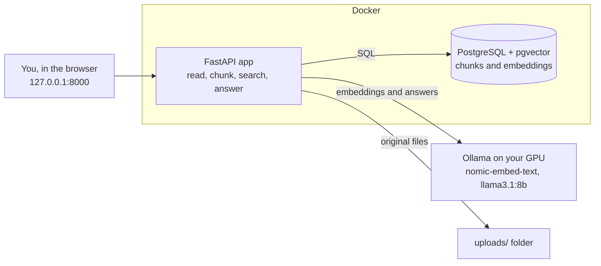

# Private Document Assistant

Ask questions about your own documents and get answers with sources. Everything runs on your own computer: no cloud, no API keys, and your documents never leave your machine.

## Demo

Demo video: coming soon.

## Status

All 12 build steps done.

- [x] Settings from `.env`
- [x] Reading PDF, Word (.docx), .txt and .md files
- [x] Cutting text into chunks (~1000 characters, never across PDF pages)
- [x] Database tables and workspaces (PostgreSQL + pgvector)
- [x] Embeddings with a local model (Ollama, `nomic-embed-text`)
- [x] Adding a document, all-or-nothing (nothing half-saved if something fails)
- [x] Answering questions with numbered sources (`llama3.1:8b`)
- [x] Deleting documents and workspaces (their files too)
- [x] Web API (FastAPI) with friendly error messages
- [x] Web page (plain HTML, CSS and JavaScript)
- [x] Quality check: 20 test questions, 20/20 with `llama3.1:8b`
- [x] One-command run with Docker Compose

## How it works

1. You create a **workspace** (for example "College") and upload documents into it.
2. The app reads the text and cuts it into small overlapping chunks.
3. A local model turns each chunk into an **embedding** (768 numbers that capture its meaning), stored in PostgreSQL with pgvector.
4. You ask a question. The app finds the 5 chunks closest in meaning, in that workspace only.
5. A local model answers using only those chunks and cites them like [1] and [2], so you can see the file (and page, for PDFs) behind each fact.

### When the answer isn't in your documents

The app says "I couldn't find this in your documents." instead of guessing. Two checks make sure of that:

- **Before the AI:** if even the closest chunk is far away in meaning, the model is never asked.
- **The AI itself:** it's told to reply `NOT_FOUND` when the excerpts don't contain the answer.

## Run the app

You need [Docker Desktop](https://www.docker.com/products/docker-desktop/) and [Ollama](https://ollama.com).

1. Download the two models (once): `ollama pull nomic-embed-text`, then `ollama pull llama3.1:8b`
2. Copy `.env.example` to `.env` and choose your own database password in it.
3. Start everything: `docker compose up -d --build`
4. Open http://127.0.0.1:8000 (or http://127.0.0.1:8000/docs to try the API routes directly).
5. Stop everything: `docker compose down` (your documents and database are kept).

Ollama runs on your computer, not in Docker, so it can use your GPU. The app reaches it through `host.docker.internal`.

## Quality check

20 questions about 4 invented documents (a handbook, a coffee machine manual PDF, a trip plan in Word, meeting notes): 15 that the documents answer and 5 that they don't. Invented facts prove the answers come from the documents, not from what the model already knows.

| Setup | Right file found | Answer correct | Said "not found" when it should |
|---|---|---|---|
| ✅ Chunks of 1000, `llama3.1:8b` (chosen) | 15/15 | 15/15 | 5/5 |
| Chunks of 500 | 15/15 | 15/15 | 5/5 |
| Chunks of 1500 | 15/15 | 15/15 | 5/5 |
| `qwen3:8b` instead of `llama3.1:8b` | 15/15 | 15/15 | 3/5 |

1000 keeps more context per chunk than 500 and gives finer sources than 1500. `qwen3:8b` invented answers to 2 of the 5 questions it should have refused, so it was rejected.

Run it yourself (with Ollama running): `.venv\Scripts\python -m eval.run_quality_check`

## Stack

- Python 3.14 + FastAPI
- PostgreSQL 17 + pgvector
- Ollama on your own GPU: `nomic-embed-text` (embeddings), `llama3.1:8b` (answers; context 8192, temperature 0.1)
- psycopg with plain SQL (no ORM), no LangChain
- Plain HTML, CSS and JavaScript
- Docker Compose (app + database)
- pytest + GitHub Actions (tests run on every push, with a fake Ollama)

## Privacy

- The app only accepts connections from `127.0.0.1` (your own computer), so other devices can't reach it.
- The database port is also only open to your own computer.
- Uploaded files and the database stay on your disk and are never committed to git or packed into the Docker image.
- Deleting a document or workspace also deletes its uploaded files.
- Text inside your documents is treated as data, never as instructions to the AI.
- The page shows document text and answers as plain text only, so hidden code in a document can't run in your browser.

## For developers

### Run the tests

You need Python 3.14, [uv](https://docs.astral.sh/uv/) and Docker Desktop.

1. Copy `.env.example` to `.env` and choose your own database password in it.
2. Start only the database: `docker compose up -d db`
3. Create the test database (once): `docker compose exec db createdb -U docassistant docassistant_test`
4. Install: `uv venv`, then `uv pip install -r pyproject.toml --group dev`
5. Run: `.venv\Scripts\python -m pytest -v` (on Mac/Linux: `.venv/bin/python -m pytest -v`)

The tests don't need Ollama. They use a fake one.

### Run the app without Docker

1. Stop the Docker app if it's running (it uses port 8000): `docker compose stop app`
2. Start the server: `.venv\Scripts\python -m uvicorn app.main:app --host 127.0.0.1 --port 8000`
3. Stop it with Ctrl + C.

## Project layout

| Path | What it does |
|---|---|
| `app/config.py` | Reads settings from `.env` |
| `app/reader.py` | Gets the text out of PDF, Word, .txt and .md files |
| `app/chunker.py` | Cuts text into chunks |
| `app/ollama_client.py` | Talks to Ollama (embeddings and answers) |
| `app/db.py` | All SQL: tables, workspaces, documents, chunks, search, deleting |
| `app/ingest.py` | Adds a document: check, read, chunk, embed, save |
| `app/rag.py` | Answers a question: search, prompt, read the reply, sources |
| `app/main.py` | The web API and the web page: routes, uploads, friendly error messages |
| `app/static/` | The web page: `index.html` (structure), `style.css` (looks), `app.js` (buttons and API calls) |
| `eval/` | Quality check: test documents, 20 questions, the script that marks the answers |
| `tests/` | Unit, database and API tests, plus the fake Ollama |
| `Dockerfile` | Packs the app into an image |
| `docker-compose.yml` | Starts the app and the database together |
| `docs/` | Design spec and build plan |