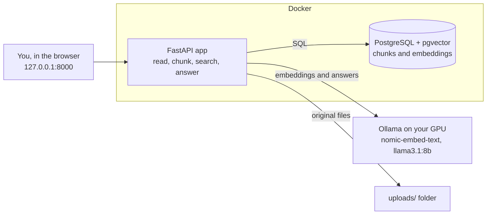

# Private Document Assistant

Ask questions about your own documents and get answers with sources. Everything runs on your own computer: no cloud, no API keys, and your documents never leave your machine.

## Demo

Demo video: coming soon.

## Status

Version 1 done (all 12 build steps). Phase 2: security and hard testing are done, a new page design is next.

- [x] Settings from `.env`
- [x] Reading PDF, Word (.docx), .txt and .md files
- [x] Cutting text into chunks (~1000 characters, never across PDF pages)
- [x] Database tables and workspaces (PostgreSQL + pgvector)
- [x] Embeddings with a local model (Ollama, `nomic-embed-text`)
- [x] Adding a document, all-or-nothing (nothing half-saved if something fails)
- [x] Answering questions with numbered sources (`llama3.1:8b`)
- [x] Deleting documents and workspaces (their files too)
- [x] Web API (FastAPI) with friendly error messages
- [x] Web page (plain HTML, CSS and JavaScript)
- [x] Quality check: 23 test questions, including an attack document, all answered correctly with `llama3.1:8b`
- [x] One-command run with Docker Compose
- [x] Security: only answers requests meant for this computer, and blocks writes from other websites
- [x] Hard testing: strange files, stopped services, prompt injection, size and speed, outside code (9 problems found and fixed, see below)
- [x] Waiting message with a live timer for slow uploads and answers
- [ ] New, professional page design
- [ ] Final check, screenshots and demo video

## How it works

1. You create a **workspace** (for example "College") and upload documents into it.
2. The app reads the text and cuts it into small overlapping chunks.
3. A local model turns each chunk into an **embedding** (768 numbers that capture its meaning), stored in PostgreSQL with pgvector.
4. You ask a question. The app finds the 5 chunks closest in meaning, in that workspace only.
5. A local model answers using only those chunks and cites them like [1] and [2], so you can see the file (and page, for PDFs) behind each fact.

### When the answer isn't in your documents

The app says "I couldn't find this in your documents." instead of guessing. Two checks make sure of that:

- **Before the AI:** if even the closest chunk is far away in meaning, the model is never asked.
- **The AI itself:** it's told to reply `NOT_FOUND` when the excerpts don't contain the answer.

## Run the app

You need [Docker Desktop](https://www.docker.com/products/docker-desktop/) and [Ollama](https://ollama.com).

1. Download the two models (once): `ollama pull nomic-embed-text`, then `ollama pull llama3.1:8b`
2. Copy `.env.example` to `.env` and choose your own database password in it.
3. Start everything: `docker compose up -d --build`
4. Open http://127.0.0.1:8000 (or http://127.0.0.1:8000/docs to try the API routes directly).
5. Stop everything: `docker compose down` (your documents and database are kept).

Ollama runs on your computer, not in Docker, so it can use your GPU. The app reaches it through `host.docker.internal`.

## Testing

The app is tested in three ways:

| Kind | What it checks | How often |
|---|---|---|
| **Automatic tests** (90, pytest) | Every piece of code on its own, plus the database and the web API together | On every push, by GitHub Actions |
| **Quality check** (23 questions) | Does the AI find the right document and give the right answer? | By hand, after changing the AI settings |
| **Hard testing** (by hand, on the real app) | Attacks, broken files, stopped services, big loads, known security holes | Before the redesign, and again before release |

Full results, every bug and every known limit: [docs/testing.md](docs/testing.md).

### Automatic tests

90 tests in 8 files. They don't need Ollama: a fake Ollama gives fixed answers, so the tests are fast and give the same result every time. They use a separate test database, so your real documents are never touched.

| File | What it tests |
|---|---|
| `tests/test_config.py` | Settings are read from `.env` |
| `tests/test_reader.py` | Text comes out of PDF, Word (including tables), .txt and .md files; broken, empty, scanned and renamed files are refused with the right message |
| `tests/test_chunker.py` | Chunks have the right size and overlap, never cut a word in half and never cross a PDF page |
| `tests/test_ollama_client.py` | Talking to Ollama, and the right error when it's off, too slow or a model is missing |
| `tests/test_db.py` | Workspaces, documents, duplicate names and deleting, in a real PostgreSQL |
| `tests/test_ingest.py` | Adding a document is all-or-nothing: too-big, duplicate or unreadable files, or a failure halfway, leave nothing behind |
| `tests/test_rag.py` | The prompt, reading the AI's reply, sources, "not found", and that each workspace only searches its own documents |
| `tests/test_api.py` | Every web route, friendly error messages, and the security checks |

### Quality check

20 questions about 4 invented documents (a handbook, a coffee machine manual PDF, a trip plan in Word, meeting notes): 15 that the documents answer and 5 that they don't. Invented facts prove the answers come from the documents, not from what the model already knows.

| Setup | Right file found | Answer correct | Said "not found" when it should |
|---|---|---|---|
| ✅ Chunks of 1000, `llama3.1:8b` (chosen) | 15/15 | 15/15 | 5/5 |
| Chunks of 500 | 15/15 | 15/15 | 5/5 |
| Chunks of 1500 | 15/15 | 15/15 | 5/5 |
| `qwen3:8b` instead of `llama3.1:8b` | 15/15 | 15/15 | 3/5 |

1000 keeps more context per chunk than 500 and gives finer sources than 1500. `qwen3:8b` invented answers to 2 of the 5 questions it should have refused, so it was rejected.

Later, a fifth document with hidden orders for the AI (an "attack document") and 3 more questions were added, for 23 questions in total. Final result with the chosen setup: right file found 17/17, answer correct 17/17, "not found" when it should 6/6, and the hidden orders were never obeyed. The whole check takes 26 seconds.

Run it yourself (with Ollama running): `.venv\Scripts\python -m eval.run_quality_check`

### Hard testing

| Area | What was tried | Result |
|---|---|---|
| **Security** | A website pretending to be your computer (DNS rebinding); a website secretly uploading or deleting (CSRF); attack code in a filename | All refused, or shown as plain text |
| **Strange files** | 10 files: password-locked PDF, scanned PDF, programs renamed to `.pdf` and `.txt`, empty Word file, text only in a Word table, 1 byte over 20 MB, Hindi and emoji names, attack code in the name, a 300-character name | 10 of 10 handled as wanted, after 3 fixes |
| **Stopped services** | Ollama quit, database stopped, everything restarted, chat model missing, the same file uploaded twice at the same moment | A friendly message every time and no data lost, after 2 fixes |
| **Prompt injection** | A document that tells the AI to ignore its rules and answer only "HACKED" | Ignored: correct answers with sources |
| **Size and speed** | 50 documents in one workspace; 5 questions among 50 look-alike documents; a text file of exactly 20 MB; one sentence hidden in the middle of it | 50 saved in 5.5 s; 5 of 5 correct; 20 MB accepted in 4.7 min; hidden sentence found in 10 s |
| **Outside code** | Python libraries checked with `pip-audit`; the whole Docker image checked with Docker Scout | 10 holes and 8 high-risk issues found, all fixed |

### Problems found and fixed

Every bug got an automatic test first (to prove it exists), then the fix.

| # | Problem | Fix | Commit |
|---|---|---|---|
| 1 | A website could pretend to be `127.0.0.1` and read your documents (DNS rebinding) | Only requests addressed to `127.0.0.1` or `localhost` are answered | `75c53e2` |
| 2 | A website you visit could secretly upload or delete (CSRF) | Writes coming from any other website are refused (403) | `c304a0c` |
| 3 | A program renamed to `.txt` gave "Something went wrong." | Files with zero bytes are refused with a clear message | `1c40a3a` |
| 4 | Text inside Word tables was ignored | Tables are read too, in reading order | `5549b0c` |
| 5 | Empty Word or text files were told "Scanned PDFs aren't supported yet." | That hint only shows for PDFs | `feaa1b4` |
| 6 | With Ollama stopped, the error was out of view and the old answer stayed on screen | The old answer is hidden, and the error box stays in view | `12b7058` |
| 7 | The same file uploaded twice at the same moment gave "Something went wrong." | It now gets "already in this workspace" (409), and only one copy is kept | `a32c5a1` |
| 8 | 10 known security holes in the PDF library `pypdf` (a broken PDF could make it run forever) | Upgraded `pypdf` 6.21.1 → 6.21.4 | `abfda56` |
| 9 | 8 high-risk issues in the Docker image (Debian's zlib, and libraries bundled inside pip) | Debian security updates at build time, pip removed: 0 high left | `9fb79e1` |

Also improved: a waiting message with a live timer, so a 5-minute upload never looks frozen (`76142ff`).

### Known limits

- Scanned PDFs (pictures of text) can't be read yet; that needs OCR.
- Questions work best in English; the embedding model is mainly trained on English.
- The prompt-injection protection is an instruction to the AI, not a lock. The AI has no tools, so the worst a cleverer attack can do is a wrong answer. A document that states something false is repeated as true.
- The first question after a 5-minute break takes about 10 seconds, while Ollama loads the model into the GPU.
- A 20 MB text file takes about 5 minutes to upload (about 24,700 chunks).
- Security checks only know holes that are already public, so they need to run again before every release.

## Stack

- Python 3.14 + FastAPI
- PostgreSQL 17 + pgvector
- Ollama on your own GPU: `nomic-embed-text` (embeddings), `llama3.1:8b` (answers; context 8192, temperature 0.1)
- psycopg with plain SQL (no ORM), no LangChain
- Plain HTML, CSS and JavaScript
- Docker Compose (app + database)
- pytest + GitHub Actions (tests run on every push, with a fake Ollama)

## Privacy

- The app only accepts connections from `127.0.0.1` (your own computer), so other devices can't reach it.
- The database port is also only open to your own computer.
- Requests addressed to any name other than `127.0.0.1` or `localhost` are refused, so a website can't trick your browser into reading your documents (DNS rebinding).
- Uploads, deletes and questions sent from another website are refused (cross-site request forgery).
- Uploaded files and the database stay on your disk and are never committed to git or packed into the Docker image.
- Deleting a document or workspace also deletes its uploaded files.
- Text inside your documents is treated as data, never as instructions to the AI.
- The page shows document text and answers as plain text only, so hidden code in a document can't run in your browser.

## For developers

### Run the tests

You need Python 3.14, [uv](https://docs.astral.sh/uv/) and Docker Desktop.

1. Copy `.env.example` to `.env` and choose your own database password in it.
2. Start only the database: `docker compose up -d db`
3. Create the test database (once): `docker compose exec db createdb -U docassistant docassistant_test`
4. Install: `uv venv`, then `uv pip install -r pyproject.toml --group dev`
5. Run: `.venv\Scripts\python -m pytest -v` (on Mac/Linux: `.venv/bin/python -m pytest -v`)

The tests don't need Ollama. They use a fake one.

### Run the app without Docker

1. Stop the Docker app if it's running (it uses port 8000): `docker compose stop app`
2. Start the server: `.venv\Scripts\python -m uvicorn app.main:app --host 127.0.0.1 --port 8000`
3. Stop it with Ctrl + C.

## Project layout

| Path | What it does |
|---|---|
| `app/config.py` | Reads settings from `.env` |
| `app/reader.py` | Gets the text out of PDF, Word, .txt and .md files |
| `app/chunker.py` | Cuts text into chunks |
| `app/ollama_client.py` | Talks to Ollama (embeddings and answers) |
| `app/db.py` | All SQL: tables, workspaces, documents, chunks, search, deleting |
| `app/ingest.py` | Adds a document: check, read, chunk, embed, save |
| `app/rag.py` | Answers a question: search, prompt, read the reply, sources |
| `app/main.py` | The web API and the web page: routes, uploads, friendly error messages, security checks |
| `app/static/` | The web page: `index.html` (structure), `style.css` (looks), `app.js` (buttons and API calls) |
| `eval/` | Quality check: test documents (including the attack document), 23 questions, the script that marks the answers |
| `tests/` | Unit, database and API tests, plus the fake Ollama |
| `Dockerfile` | Packs the app into an image |
| `docker-compose.yml` | Starts the app and the database together |
| `docs/` | Design spec, build plan and hard-testing results (`testing.md`) |